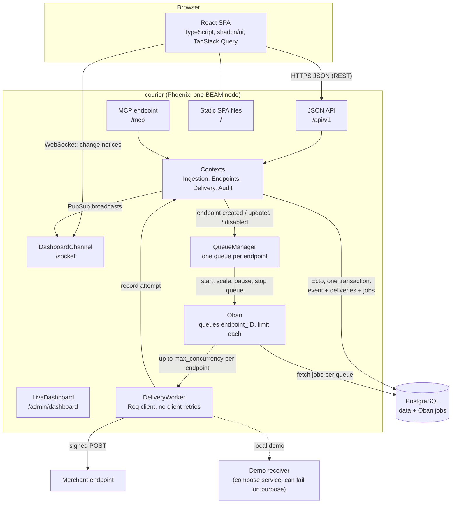
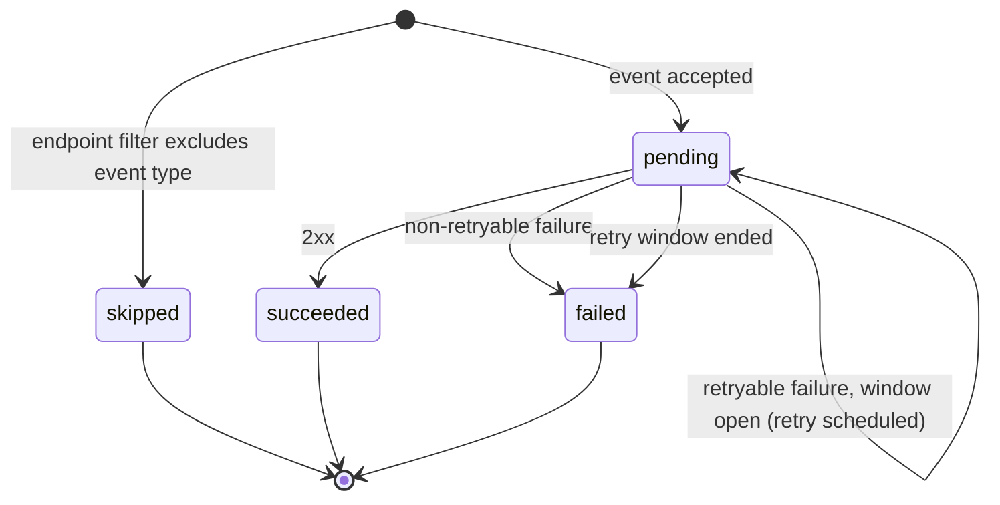

# courier

A reliable **webhook delivery engine** in Elixir, with a React + shadcn/ui dashboard and an MCP server so AI agents can query and operate it.

- Idempotent ingestion: a repeated `Idempotency-Key` returns the original event.
- At-least-once delivery, signed with [Standard Webhooks](https://www.standardwebhooks.com/) (HMAC-SHA256).
- Retries with exponential backoff, jitter and `Retry-After`, inside a retry window of up to 24 h; then a dead-letter state.
- One queue per endpoint, so a slow merchant never delays the others.
- Append-only audit trail of every attempt; manual resend that never rewrites history.
- MCP server: read-only tools by default, a separate tool for resends.

> **Status:** everything described here works end to end: idempotent ingestion, signed delivery with retries and dead letters, manual resend, endpoint health and telemetry; the React dashboard (events, deliveries, failed view, endpoints and merchants management, live updates, a sidebar with a merchant switcher, and light and dark mode); an MCP server for AI agents (see [Use it from Claude Code](#use-it-from-claude-code)); data retention; and demo tools and a load test with measured performance, to see it all locally (see [Local demo](#local-demo)). See [docs/roadmap.md](docs/roadmap.md) for the build path.

## How it works

Containers: one Phoenix node with the JSON API, MCP, per-endpoint Oban queues and the delivery worker, on one PostgreSQL database.



Delivery lifecycle: a resend never changes these states; it creates a new delivery that starts at `pending`.



## Local demo

Shows successes, retries, dead letters, skipped deliveries, a slow endpoint and a manual resend with real signed requests. It needs Elixir and Erlang (versions in `mise.toml`), PostgreSQL and three terminals. The demo tools are described in [docs/architecture.md](docs/architecture.md#demo-tools).

**1. Start PostgreSQL** (or use a local one) and fetch the dependencies:

```sh
docker compose up -d postgres
mix deps.get
```

**2. Start the demo receiver** (terminal 1). It plays the merchants' side on `127.0.0.1:4001`, checks every signature with its own code and logs one line per webhook:

```sh
mix courier.demo.receiver
```

**3. Create the database and the demo data** (terminal 2). Do it while the receiver runs, so the seeds can register each endpoint's signing secret with it:

```sh
mix ecto.reset
```

The output shows, only this once, the token of the `demo` API key, three merchants, five endpoints (one per receiver behaviour) and a ready `mix courier.simulate` command. Keep it at hand. `mix ecto.reset` drops the development database; run it again whenever you want a fresh demo.

**4. Start courier** (terminal 2):

```sh
mix phx.server
```

**5. Send events** (terminal 3) with the command the seeds printed. It sends 100 events at 5 per second, about 10% of them exact repeats:

```sh
mix courier.simulate --token ck_... --merchant <id> --merchant <id> --merchant <id>
```

The summary counts new events (`202`) and repeats (`200`): a repeated `Idempotency-Key` returns the original event and creates no delivery. Terminal 1 shows the webhooks arriving with `signature=valid`.

**6. Look at the deliveries.** Each event creates one delivery per endpoint of its merchant. List a merchant's events, open one to get its delivery ids, then open a delivery to see its attempts:

```sh
export TOKEN=ck_...   # the demo key
curl -s -H "authorization: Bearer $TOKEN" "http://localhost:4000/api/v1/events?merchant_id=<merchant id>"
curl -s -H "authorization: Bearer $TOKEN" http://localhost:4000/api/v1/events/<event id>
curl -s -H "authorization: Bearer $TOKEN" http://localhost:4000/api/v1/deliveries/<delivery id>
```

What to look for in `GET /api/v1/deliveries/:id` (`status`, `attempt_count`, `next_attempt_at`, `window_ends_at`, and each of the `attempts` with its `response_status`, `error` and `duration_ms`):

| Merchant | Endpoint | What its deliveries show |
|---|---|---|
| Sunrise Bakery | `sunrise-ok` | `succeeded` after one attempt with `200`; `skipped`, with no attempts, for `refund.succeeded` events, which its `payment.*` filter leaves out |
| Harbor Outfitters | `harbor-fail` | `pending` with a growing list of `500` attempts and a `next_attempt_at` that backs off; `failed` (dead letter) within 5 minutes, when its retry window ends |
| Harbor Outfitters | `harbor-rate-limit` | `pending` with `429` attempts, retried no sooner than the receiver's `Retry-After` of 30 s |
| Pine Hardware | `pine-bad-request` | `failed` after a single `400` attempt: a `4xx` is not retried |
| Pine Hardware | `pine-timeout` | attempts with the error `timeout` after 15 s, two at a time; the other endpoints keep their pace meanwhile |

**7. Open the dashboard** at <http://localhost:4000/admin/dashboard> (any user name; the password in development is `courier-dev-admin-token-not-a-secret`). Under **Metrics**, the `courier` tab shows events ingested by type, attempts by outcome and their duration, deliveries succeeded and failed, retries scheduled, and the lag of each endpoint's queue: the queue of `pine-timeout` falls behind while the others stay near zero.

**8. Fix an endpoint and resend.** Point `harbor-fail` at the receiver's `/ok` path (its endpoint id is in the seeds' output), then resend one of its `failed` deliveries:

```sh
curl -s -X PATCH http://localhost:4000/api/v1/endpoints/<harbor-fail endpoint id> \
  -H "authorization: Bearer $TOKEN" -H "content-type: application/json" \
  -d '{"url": "http://localhost:4001/hooks/harbor-fail/ok"}'

curl -s -X POST -H "authorization: Bearer $TOKEN" \
  http://localhost:4000/api/v1/deliveries/<failed delivery id>/resend
```

The resend answers `202` with a new delivery, linked to the old one by `resend_of_id` and with `triggered_by` set to `api_key:demo`; it succeeds on its first attempt. The failed delivery and its attempts stay as they were, and it now lists the new one under `resends`. Deliveries of `harbor-fail` that were still `pending` succeed on their next retry. A `pending` delivery cannot be resent (`409 delivery_in_progress`).

**9. Do it in the dashboard.** Open <http://localhost:4000> (after `npm run build --prefix frontend`; or <http://localhost:5173> with `npm run dev --prefix frontend`), choose **Sign in** and paste the `demo` key. The sidebar lists the pages (Overview, then **Activity**: Events, Deliveries, Failed, and **Configuration**: Endpoints, Merchants), shows the key in use with **Sign out** at the bottom, and collapses to icons with the toggle in the header. The sun/moon button in the header (on every page, signed in or not) switches between **Light**, **Dark** and **System**; the choice is remembered in the browser, and System follows the operating system. The switcher at its top-left lists **All merchants** and the merchants: pick one (for example `harbor`) to keep the Events, Deliveries, Failed and Endpoints lists on that merchant for the browser session. It only filters the view; the key still sees every merchant. Open **Failed** to list failed deliveries, open one of `harbor-fail` to see its attempt timeline, and press **Resend**. Confirm the dialog: the new delivery opens, linked to the old one, and succeeds once the endpoint points at `/ok` (step 8).

**10. Find a degraded endpoint and rotate its secret.** In the dashboard open **Endpoints**, turn on **Degraded only** and open `harbor-fail` (it shows as degraded once it has failed enough consecutive attempts; until then the filter is empty). Press **Rotate secret** and confirm: the new secret is shown once, with the time the previous one stops signing. Endpoints created in the dashboard are not registered with the demo receiver, so it cannot verify their signatures; it only knows the secrets the seeds registered.

**11. Watch it update live.** In the dashboard keep **Failed** open (the indicator in the layout shows it is live). Run the simulator again (`bin/simulate` with Docker, or the command from step 4) and watch the list fill with new failed deliveries, and an open delivery gain attempts, without reloading; changes appear within a few seconds. If the server restarts, the indicator shows it is reconnecting, then live again, and the page refetches what it missed.

**With Docker.** Only Docker is needed; this replaces steps 1 to 4.

```sh
docker compose up -d --build                 # courier, PostgreSQL and the demo receiver
docker compose exec courier bin/seed         # creates the demo data and prints the next command
docker compose exec courier bin/simulate ... # run the command that bin/seed printed, as printed
docker compose logs -f demo-receiver         # one line per webhook, with signature=valid
```

The API and the dashboard (step 9, signing in with the key `bin/seed` printed) are at <http://localhost:4000>. LiveDashboard (step 7) is at <http://localhost:4000/admin/dashboard>: any user name, and the password is `COURIER_ADMIN_TOKEN` in `compose.yaml` (`courier-demo-admin-token-not-a-secret`). For the resend (step 8), use `http://demo-receiver:4001/hooks/harbor-fail/ok` as the endpoint's URL, because the receiver is only reachable inside Compose. To start again from an empty database, run `docker compose down -v` first. See [Docker demo](docs/architecture.md#docker-demo) for how it is built.

## Measured performance

The non-functional targets (ingestion latency and throughput, time to first attempt, delivery throughput) are in the table in [docs/analysis.md](docs/analysis.md#non-functional-requirements). `mix courier.load` measures them: it sends distinct events at a rate (reusing the simulator's pacing), then reports the ingestion latency (p50, p95, p99) and, from the database, the time to first attempt overall and per endpoint (so a slow endpoint's isolation shows) and the attempts per second. It waits up to `--wait` seconds for the run's deliveries to get their first attempt and says how many did not.

```sh
export COURIER_INGEST_TOKEN=ck_...   # a key with the ingest scope
mix courier.load --merchant <merchant id> --merchant <merchant id> --rate 50 --count 1500
```

With Docker, `docker compose exec courier bin/load --token ck_... --merchant <merchant id> --rate 50 --count 1500` takes the same options. Defaults: `--rate 50`, `--count 500`, `--wait 30`, `--url http://localhost:4000`. Numbers depend on the machine and on the demo receiver; see [Load test](docs/architecture.md#load-test).

## Dashboard development

The dashboard is a React SPA in `frontend/` (see [Dashboard SPA](docs/architecture.md#dashboard-spa)). With `mix phx.server` running:

```sh
cd frontend
npm install
npm run dev      # http://localhost:5173, proxies /api and /socket to Phoenix
npm run check    # format, lint, type-check and tests
npm run build    # writes priv/static, served by Phoenix at http://localhost:4000
```

## Use it from Claude Code

courier serves MCP at `/mcp`, so an agent can answer "why did this webhook fail?" with the same data and rules as the API. Connect Claude Code with a key that has `read` (and `write` to allow resends), such as the `demo` key from the seeds:

```sh
claude mcp add --transport http courier http://localhost:4000/mcp \
  --header "Authorization: Bearer ck_..."
```

Then ask in plain language. One example per tool:

| Tool | Example question |
|---|---|
| `get_event` | "Show me event `<event id>` and the state of each of its deliveries." |
| `get_delivery` | "Why did delivery `<delivery id>` fail? Walk me through its attempts." |
| `list_deliveries` | "List the pending deliveries of endpoint `<endpoint id>`, newest first." |
| `list_failed_deliveries` | "Which deliveries have failed for good? Group them by endpoint." |
| `get_endpoint_health` | "Is endpoint `<endpoint id>` degraded? How many of its deliveries are failed or pending?" |
| `resend_delivery` | "The endpoint is fixed now: resend delivery `<delivery id>`." |

Read tools never change anything; `resend_delivery` needs a `write` key and creates a new delivery without touching the old one. Payloads and response bodies are handed to the agent as untrusted data, and every call is logged with the key's name. Details in [MCP server](docs/architecture.md#mcp-server).

## Data retention

A daily job (03:30 UTC) deletes events whose deliveries have all finished and whose last activity is older than the retention period, together with their deliveries and attempts. Events with a `pending` delivery are kept. Set the period in whole days with `COURIER_RETENTION_DAYS` (default `30`, minimum `2`); any other value stops courier at boot:

```sh
COURIER_RETENTION_DAYS=7 mix phx.server
```

With Docker, add it to the `courier` service's `environment` in `compose.yaml`.

Once an event is pruned, its `Idempotency-Key` can be reused: sending the same key again creates a new event (`202`) instead of returning the old one. Each run logs one line such as `retention pruned events=3 deliveries=5 attempts=9 days=30`. Details in [Retention](docs/architecture.md#retention).

## Documentation

| Document | Contents |
|---|---|
| [docs/analysis.md](docs/analysis.md) | Problem, requirements (FR-1…FR-41), non-functional targets, risks |
| [docs/architecture.md](docs/architecture.md) | Context, container and sequence diagrams, data model, API surface |
| [docs/decisions.md](docs/decisions.md) | Architecture decision records (ADRs) |
| [docs/roadmap.md](docs/roadmap.md) | Build path and current status |
| [docs/development.md](docs/development.md) | How the project is built: specs, agents and Smelt |

## How it is built

Requirements and decisions come first; then each change is specified with [OpenSpec](https://github.com/Fission-AI/OpenSpec) and implemented task by task by AI agents (Claude Code) through **[Smelt](https://github.com/fabianskier/smelt)**, the author's own software factory built in Elixir/OTP, public for review under an "all rights reserved" notice. Smelt runs each task in its own git worktree, checks it with a deterministic gate (protected tests, small diffs, spec validation, compile, format and tests) and merges only after human approval. Smelt is not required to build, run or test courier.

More in [docs/development.md](docs/development.md), including what Smelt does today and what is still to come.

## Stack

Elixir, Phoenix (JSON API and Channels), Ecto, PostgreSQL, Oban, Req · React, TypeScript, Vite, TanStack Router and Query, Tailwind, shadcn/ui · MCP (`anubis_mcp`) · Docker Compose.

## License

Copyright (c) 2026 Oscar Fabián Cristaldo Guzmán. All rights reserved. The code is published for review only; see [LICENSE](LICENSE).
