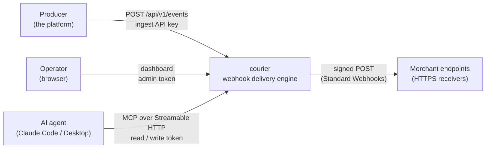
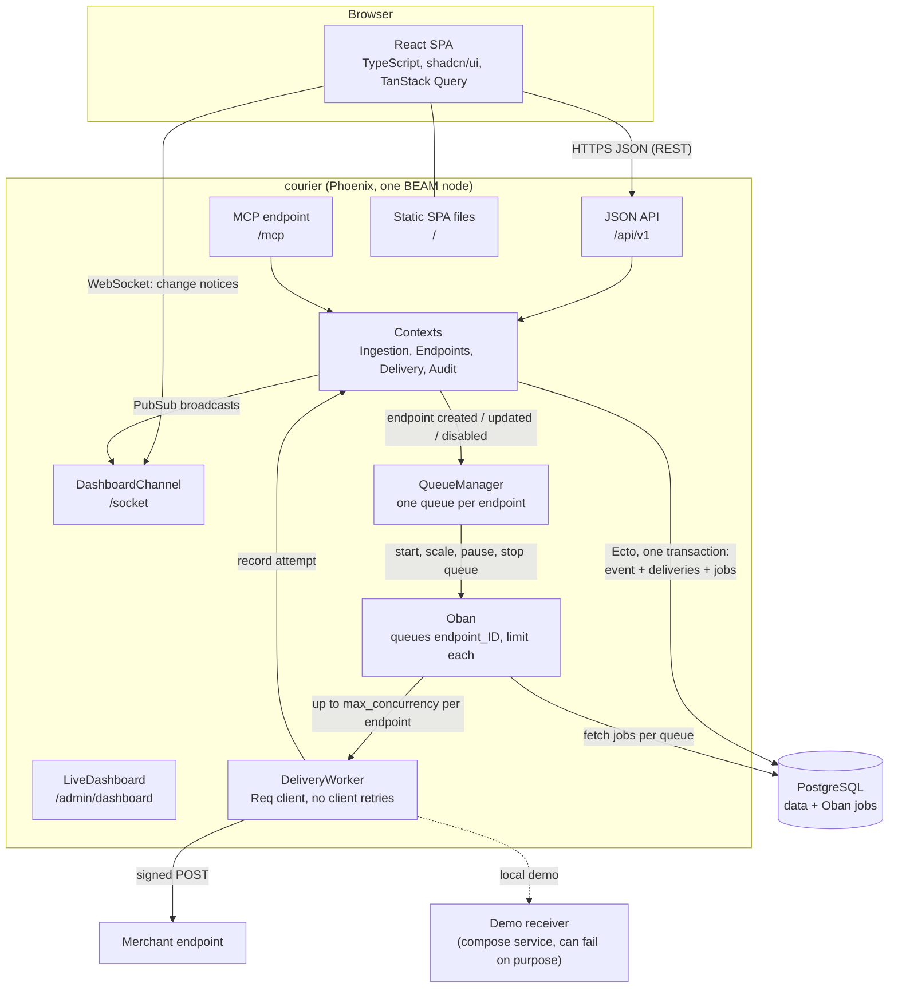
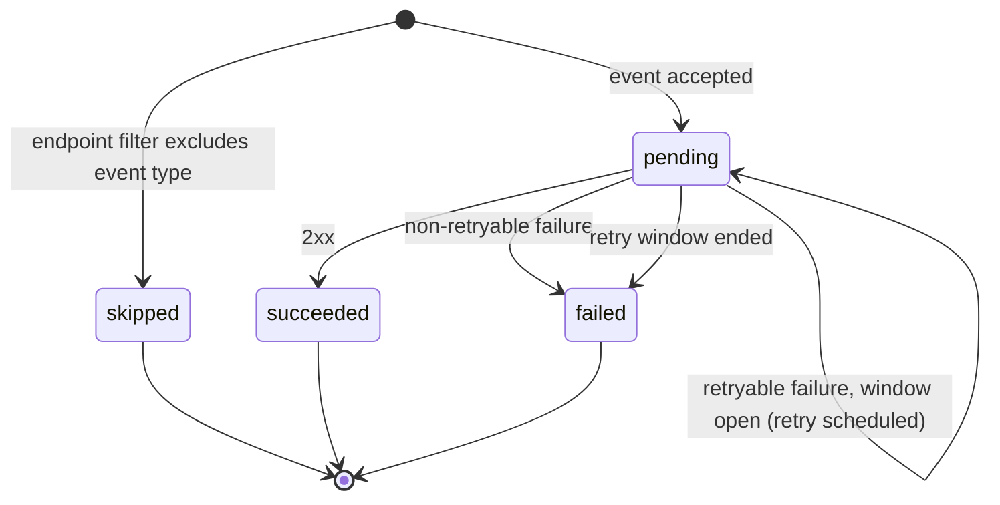
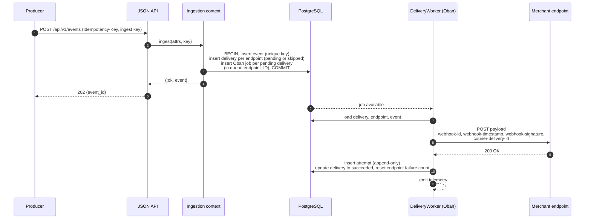
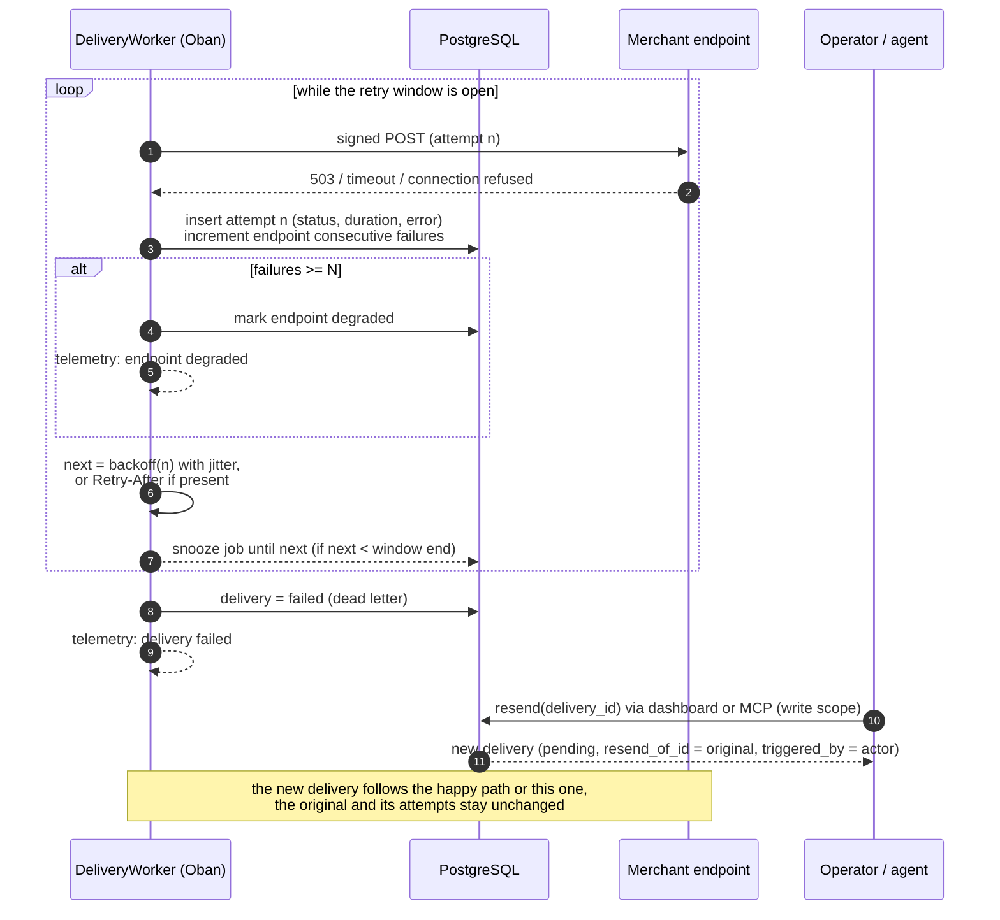

# Architecture

It reflects the decisions in [decisions.md](decisions.md); it changes when a decision changes.

## Overview

`courier` is a single Phoenix application (one BEAM node) backed by PostgreSQL. Oban runs inside the same node and uses the same database, so an event, its deliveries and their jobs are written in **one transaction**. A React single-page app and an MCP endpoint sit on top of the same contexts as the JSON API.

## Context



## Containers



Notes:

- **One deployable.** API, MCP, delivery workers and LiveDashboard run in the same release. The web layer and the MCP layer are thin adapters over the contexts in `lib/courier/`.
- **Concurrency and isolation.** Each enabled endpoint has its own Oban queue (`endpoint:<id>`) with its own limit, so deliveries run concurrently across endpoints and a slow endpoint only uses its own slots. `QueueManager` keeps the running queues in sync with the endpoints table (at boot and on every endpoint change).
- **Dashboard updates.** Contexts broadcast changes over PubSub; `DashboardChannel` forwards small notices (ids and statuses) and the SPA invalidates its TanStack Query caches, then refetches over REST.
- **Local runtime.** `docker compose up` starts `courier`, `postgres` and `demo-receiver`. Developers can also run with mise + a local Postgres.
- **SPA.** Built by Vite into `priv/static` and served by Phoenix on the same origin (no CORS). In development the Vite dev server proxies `/api` and `/socket` to Phoenix.

## Code layout (proposed)

```text
lib/courier/                 domain (contexts)
  ingestion/                 events, idempotency
  endpoints/                 merchants, endpoints, filters, secrets, URL safety
  delivery/                  deliveries, worker, queue manager, backoff, signer, HTTP client
  audit/                     attempts (append-only), queries for timelines
  access/                    API keys and scopes
lib/courier_web/             thin web layer: router, controllers, JSON views, plugs
lib/courier_mcp/             thin MCP adapter: tool definitions -> context calls
frontend/                    React SPA (Vite, TypeScript, shadcn/ui)
demo/receiver/               small Plug app that verifies signatures and fails on purpose (FR-41)
docs/                        analysis, architecture, decisions
openspec/                    specs and changes
```

## Delivery lifecycle



A resend never changes these states: it creates a **new** delivery (`resend_of_id` → original) that starts at `pending`.

## Sequence: happy path



Repeat with the same key and body: step 3 hits the unique constraint, the transaction rolls back, and the API returns `200` with the original event (FR-2). Same key with a different body → `422` (FR-3).

## Sequence: failure path (retries, then dead letter)



A non-retryable result (for example `400`, `404` or a `3xx`) skips the loop: one attempt is stored and the delivery becomes `failed` at once.

## Retry timing

- Attempt `n` (starting at 1) waits `random(0, min(cap, base * 2^(n-1)))` with base 10 s and cap 1 h, plus a small floor, unless `Retry-After` asks for longer (bounded by the cap).
- The worker computes the next run time itself and **snoozes** the Oban job. It does not rely on Oban's `max_attempts` to end retries: the **retry window** (`delivery.inserted_at + endpoint.retry_window`) is the only stop rule, so the policy is easy to test and to show in the UI ("next attempt at …", "gives up at …").
- In Oban 2.24 a snooze does not consume an attempt (it only increments `meta.snoozed`), so `max_attempts` stays a safety net, not the policy.
- Req runs with `retry: false` and explicit `connect` and `receive` timeouts. Oban is the only layer that retries.
- The HTTP connection pool per endpoint origin is at least the endpoint's `max_concurrency`, so the pool never becomes a hidden second limit.

## Data model sketch


Key constraints:

- `events.idempotency_key` unique. One producer in v1, so the key is global.
- `deliveries (event_id, endpoint_id)` unique **where `resend_of_id` is null**: one original delivery per endpoint, any number of resends.
- `attempts (delivery_id, number)` unique. The application only ever inserts rows; a database trigger rejects `UPDATE` on `attempts`, and `DELETE` unless the transaction set `courier.retention = on`, which only the retention job does (FR-19, FR-37).
- Delivery status changes only forward (`pending` → terminal), enforced in the context and checked by a test.

## API surface (sketch)

| Method and path | Scope | Purpose |
|---|---|---|
| `POST /api/v1/events` | ingest | Ingest an event (FR-1 to FR-5) |
| `GET /api/v1/events`, `GET /api/v1/events/:id` | read | List and show events |
| `GET /api/v1/deliveries`, `GET /api/v1/deliveries/:id` | read | List (filters, cursor) and show with attempts |
| `POST /api/v1/deliveries/:id/resend` | write | Manual resend (FR-21 to FR-23) |
| `GET/POST/PATCH /api/v1/merchants[/:id]` | read / write | Merchants |
| `GET/POST/PATCH /api/v1/endpoints[/:id]`, `POST /api/v1/endpoints/:id/rotate_secret` | read / write | Endpoints, filters, secrets |
| `POST /mcp` | read / write | MCP (Streamable HTTP) |
| `/socket` (WebSocket), topics `deliveries`, `endpoints` | read | Dashboard change notices (Phoenix Channels) |

Errors follow one JSON shape: `{"error": {"code": "...", "message": "...", "details": {...}}}`.

## Security notes

- API keys are random tokens stored as SHA-256 hashes; the plaintext is shown once. Scopes: `ingest`, `read`, `write`.
- Endpoint secrets are encrypted at rest because they must be readable to sign; the encryption key comes from the environment.
- URL validation runs at creation **and** before every request (after DNS resolution), with a dev/demo-only host allowlist.
- Secrets, full signatures and `Authorization` headers are never logged or stored.
- MCP tool results mark payloads and response bodies as untrusted data; `resend_delivery` needs `write` scope.
